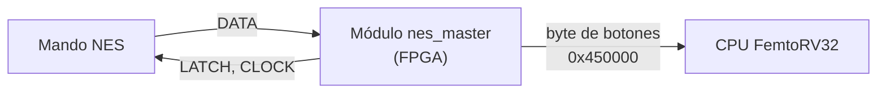

# Controlador NES

En el presente repositorio se encuentran los avances producidos y la información general para el desarrollo y la conexión del periférico mando NES en la consola KUBIX.

## Contenido

1. [Visión general](#1-visión-general)
2. [Conexión física](#2-conexión-física)
3. [Cómo funciona el mando](#3-cómo-funciona-el-mando)
4. [Protocolo de comunicación](#4-protocolo-de-comunicación)
5. [Especificaciones eléctricas](#5-especificaciones-eléctricas)
6. [Diseño interno](#6-diseño-interno)
7. [Interfaz con la CPU](#7-interfaz-con-la-cpu)
8. [Documentación adicional](#8-documentación-adicional)

---

## 1. Visión general

El mando se comunica con el SoC por un bus serie síncrono de solo lectura, con un modelo maestro-esclavo:

- **Master (maestro):** el módulo de la FPGA. Genera LATCH y CLOCK, y lee DATA.
- **Slave (esclavo):** el mando físico de la NES. Responde a cada pulso que recibe.

El mando envía **un byte** (8 botones), bit a bit, por la línea DATA.

## 2. Conexión física

| Señal | Dirección (desde la FPGA) | Descripción |
|---|---|---|
| `nes_latch` | Salida | Captura el estado de los botones |
| `nes_clk` | Salida | Desplaza los bits hacia DATA |
| `nes_data` | Entrada | Un botón por pulso (lógica negativa) |
| VCC / GND | Alimentación | 5 V / 0 V |

> **Ojo con el voltaje:** el mando funciona a 5 V y muchas FPGAs aceptan máximo 3,3 V. Verifica que el pin de DATA tolere 5 V; si no, usa un divisor de voltaje o un conversor de niveles.

## 3. Cómo funciona el mando

Dentro del mando hay un **registro de desplazamiento** que recibe los 8 botones a la vez y los entrega uno por uno. Con un pulso en LATCH copia el estado de todos los botones. Cada pulso de CLOCK hace aparecer el siguiente botón en DATA.

## 4. Protocolo de comunicación

Cada **16,6 ms** (60 Hz) se repite esta secuencia:

1. El master sube **LATCH** durante **12 µs**. El mando "congela" los botones.
2. Al bajar LATCH, DATA muestra el primer bit: el botón **A**.
3. El master envía **7 pulsos de CLOCK** (6 µs en alto y 6 µs en bajo). Cada pulso muestra el siguiente botón.
4. Con los 8 bits leídos, espera hasta completar los 16,6 ms y repite.

**Lógica negativa:** un botón presionado vale `0` y uno suelto vale `1`. Por eso cada bit pasa por una compuerta NOT al llegar a la FPGA. Ejemplo con Start presionado:

## 5. Especificaciones eléctricas

- Comunicación serie, síncrona y unidireccional.
- La FPGA controla LATCH y CLOCK, y recibe DATA.
- Niveles TTL / LVTTL (5 V o 3,3 V): nivel bajo con $V_{IL} < 0{,}8\ \text{V}$ y nivel alto con $V_{IH} > 2{,}0\ \text{V}$.

## 6. Diseño interno

El módulo `nes_master` está formado por una **máquina de control** ([`nes_control.v`](rtl/nes_control.v)), que decide el orden de los pasos, y un **datapath** ([`nes_datapath.v`](rtl/nes_datapath.v)), que cuenta tiempo, guarda los bits y aplica el NOT. [`nes_master.v`](rtl/nes_master.v) los une.

### 6.1 Diagrama de caja negra

### 6.2 Diagrama de flujo

### 6.3 Máquina de control

| Estado | Qué hace |
|---|---|
| `IDLE` | Espera hasta el siguiente ciclo |
| `LATCH` | Mantiene LATCH en alto 12 µs |
| `WAIT` | CLOCK en bajo, espera 6 µs |
| `CAPTURE` | Guarda el bit que hay en DATA |
| `CLK_HI` | Mantiene CLOCK en alto 6 µs |
| `DONE` | Entrega el byte a la CPU y activa "Dato Listo" |

> El parámetro `CLK_FREQ_HZ` (50 MHz por defecto) debe coincidir con el reloj de la FPGA. De él se calculan todos los tiempos.

## 7. Interfaz con la CPU

| Dirección | Registro | Descripción |
|---|---|---|
| `0x450000` | Botones | Un byte: `1` = botón presionado |
| `0x450008` | Dato Listo | Indica que hay un byte nuevo |

| Botón | Bit | Máscara |
|---|:-:|:-:|
| A | 0 | `0x01` |
| B | 1 | `0x02` |
| Select | 2 | `0x04` |
| Start | 3 | `0x08` |
| Arriba | 4 | `0x10` |
| Abajo | 5 | `0x20` |
| Izquierda | 6 | `0x40` |
| Derecha | 7 | `0x80` |

Ejemplo: con solo Start presionado el byte vale `0x08`. En C, un botón está presionado si `(data & máscara) != 0`.

## 8. Documentación adicional

| Documento | Contenido |
|---|---|
| [`def_tramas.md`](def_tramas.md) | Tramas, polaridad lógica y vectores de prueba |
| [`mapa_controlador_NES.md`](mapa_controlador_NES.md) | Orden de los bits y máscaras en C |
| [`verificacion_botones.md`](verificacion_botones.md) | Enmascaramiento, flancos y filtro de direcciones opuestas |

## Autores

- Juana Valentina Saavedra
- Manuel Alejandro Velasco Marinez
