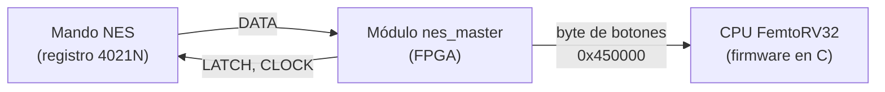
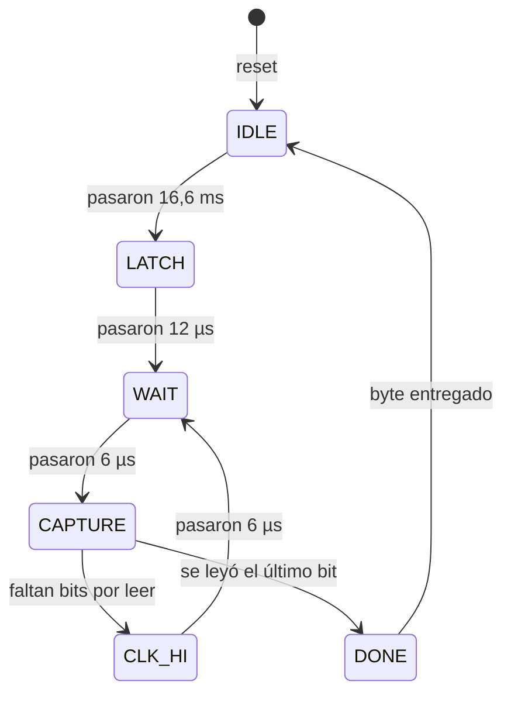

# Controlador NES 
En el presente repositorio se encuentran los avances producidos e información general para el desarrollo y conexión del períferico mando NES en la consola KUBIX.

## Contenido

1. [Visión general](#1-visión-general)
2. [Conexión física](#2-conexión-física)
3. [Cómo funciona el mando](#3-cómo-funciona-el-mando)
4. [Protocolo de comunicación](#4-protocolo-de-comunicación)
5. [Especificaciones eléctricas](#5-especificaciones-eléctricas)
6. [Diseño interno: máquina de control y datapath](#6-diseño-interno-máquina-de-control-y-datapath)
7. [Interfaz con la CPU](#7-interfaz-con-la-cpu)
8. [Estructura del repositorio](#8-estructura-del-repositorio)
9. [Simulación](#9-simulación)
10. [Documentación adicional](#10-documentación-adicional)
11. [Pendientes](#11-pendientes)

---

## 1. Visión general

El protocolo entre el SoC y el mando es un **bus serie síncrono y unidireccional de lectura**, con un modelo maestro-esclavo:

| Rol | Quién es | Qué hace |
|---|---|---|
| **Master (maestro)** | El módulo de la FPGA / SoC | Genera LATCH y CLOCK, fija los tiempos y lee DATA |
| **Slave (esclavo)** | El mando físico de la NES | Reacciona a cada pulso que recibe del master |

El mando transmite **un byte** (8 botones), bit a bit, por la línea DATA. Cada botón ocupa un bit fijo del byte (ver [sección 7](#7-interfaz-con-la-cpu)).

## 2. Conexión física

| Señal | Dirección (vista desde la FPGA) | Descripción |
|---|---|---|
| `nes_latch` | Salida | Pulso que captura el estado de los botones |
| `nes_clk` | Salida | Pulsos que desplazan los bits hacia DATA |
| `nes_data` | Entrada | Estado de un botón por pulso (lógica negativa) |
| VCC | Alimentación | 5 V |
| GND | Tierra | 0 V |

> **Advertencia sobre voltajes:** el mando original funciona a 5 V. Muchas FPGAs aceptan como máximo 3,3 V en sus pines. Antes de conectar DATA, verifica que el pin de tu FPGA tolere 5 V; si no, usa un divisor de voltaje o un conversor de niveles. **[COMPLETAR: cómo lo resuelve este proyecto]**

## 3. Cómo funciona el mando

El mando contiene un **registro de desplazamiento 4021N** (entrada en paralelo, salida en serie). Los 8 botones están conectados a sus 8 entradas en paralelo. Con un pulso en LATCH el chip copia el estado de todos los botones a la vez. Después, cada pulso de CLOCK desplaza el contenido y hace aparecer el siguiente botón en la línea DATA.

## 4. Protocolo de comunicación

Aproximadamente cada **16,6 ms** (a 60 Hz) se repite esta secuencia:

1. El master sube **LATCH** durante **12 µs**. El mando "congela" el estado de los botones.
2. El master baja LATCH. En ese momento la línea DATA muestra el primer bit: el botón **A**.
3. El master envía **7 pulsos de CLOCK** (6 µs en alto y 6 µs en bajo). Después de cada pulso, DATA muestra el siguiente botón.
4. Se leyeron 8 bits en total. El master espera hasta completar los 16,6 ms y repite.

**Lógica negativa:** en la línea DATA un botón presionado vale `0` y uno suelto vale `1`. Por eso, al llegar a la FPGA, cada bit pasa por una compuerta NOT. Ejemplo con Start presionado:

| Parámetro | Valor |
|---|---|
| Ancho del pulso LATCH | 12 µs |
| CLOCK en alto / en bajo | 6 µs / 6 µs |
| Periodo entre lecturas | 16,6 ms (60 Hz) |
| Pulsos de CLOCK por lectura | 7 |

## 5. Especificaciones eléctricas

- Comunicación serie, síncrona y unidireccional.
- La FPGA controla las líneas LATCH y CLOCK, y recibe DATA.
- Niveles lógicos TTL / LVTTL (5 V o 3,3 V): nivel bajo con $V_{IL} < 0{,}8\ \text{V}$ y nivel alto con $V_{IH} > 2{,}0\ \text{V}$.
- DATA usa lógica negativa (activa en bajo).

## 6. Diseño interno: máquina de control y datapath

El módulo `nes_master` se divide en dos bloques:

| Bloque | Archivo | Función |
|---|---|---|
| **Máquina de control** | [`rtl/nes_control.v`](rtl/nes_control.v) | FSM que decide el orden de los pasos. No guarda datos ni cuenta tiempo. |
| **Datapath (unidad de datos)** | [`rtl/nes_datapath.v`](rtl/nes_datapath.v) | Cuenta tiempo, guarda los bits y aplica el NOT. Obedece a la máquina de control. |
| **Módulo superior** | [`rtl/nes_master.v`](rtl/nes_master.v) | Une ambos bloques y registra las salidas hacia el mando. |

El mismo diagrama en texto (GitHub lo dibuja solo):

| Estado | Qué hace |
|---|---|
| `IDLE` | Espera hasta el siguiente ciclo de lectura |
| `LATCH` | Mantiene LATCH en alto 12 µs |
| `WAIT` | CLOCK en bajo, espera 6 µs |
| `CAPTURE` | Guarda el bit que hay en DATA |
| `CLK_HI` | Mantiene CLOCK en alto 6 µs |
| `DONE` | Entrega el byte a la CPU y activa "Dato Listo" |

El diagrama de flujo completo y la tabla de salidas están en [`docs/diagrama_flujo.md`](docs/diagrama_flujo.md).

**Parámetro importante:** `CLK_FREQ_HZ` (por defecto 50 MHz) debe coincidir con el reloj de tu FPGA. De él se calculan todos los tiempos.

## 7. Interfaz con la CPU

| Dirección | Registro | Acceso | Descripción |
|---|---|---|---|
| `0x450000` | Botones | Lectura | Un byte con lógica activa en alto: `1` = botón presionado |
| `0x450008` | Dato Listo | Lectura | Indica que hay un byte nuevo. **[COMPLETAR: bit usado y cómo se borra]** |

Orden de los bits del byte y máscaras para el firmware en C:

| Botón | Bit | Máscara | Condición en C |
|---|:-:|:-:|---|
| A | 0 | `0x01` | `(data & 0x01) != 0` |
| B | 1 | `0x02` | `(data & 0x02) != 0` |
| Select | 2 | `0x04` | `(data & 0x04) != 0` |
| Start | 3 | `0x08` | `(data & 0x08) != 0` |
| Arriba | 4 | `0x10` | `(data & 0x10) != 0` |
| Abajo | 5 | `0x20` | `(data & 0x20) != 0` |
| Izquierda | 6 | `0x40` | `(data & 0x40) != 0` |
| Derecha | 7 | `0x80` | `(data & 0x80) != 0` |

Ejemplo: con solo Start presionado el byte vale `0x08`, y solo la condición de Start da verdadero. El firmware completo (flancos, filtro de direcciones opuestas) está en [`verificacion_botones.md`](verificacion_botones.md).

## 9. Documentación adicional

| Documento | Contenido |
|---|---|
| [`def_tramas.md`](def_tramas.md) | Qué es una trama, polaridad lógica, trama de reposo y desconexión, vectores de prueba |
| [`mapa_controlador_NES.md`](mapa_controlador_NES.md) | Orden de salida de los bits y constantes de enmascaramiento en C |
| [`verificacion_botones.md`](verificacion_botones.md) | Enmascaramiento, detección de flancos y filtro de direcciones opuestas |
| [`docs/diagrama_flujo.md`](docs/diagrama_flujo.md) | Diagrama de flujo y diagrama de estados del módulo |
| [Diagrama original (draw.io)](img/Diagrama%20de%20Flujo-Controlador%20NES.drawio%282%29.png) | Versión anterior del diagrama de flujo |

.

## Autores

**[Juana Valentina Saavedra-Manuel Alejandro Velasco Marinez]** 
