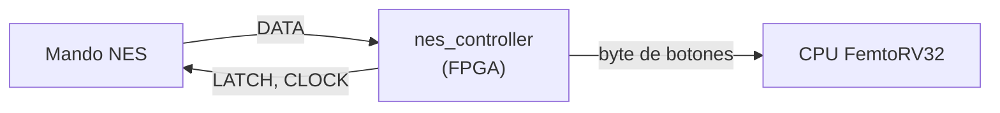
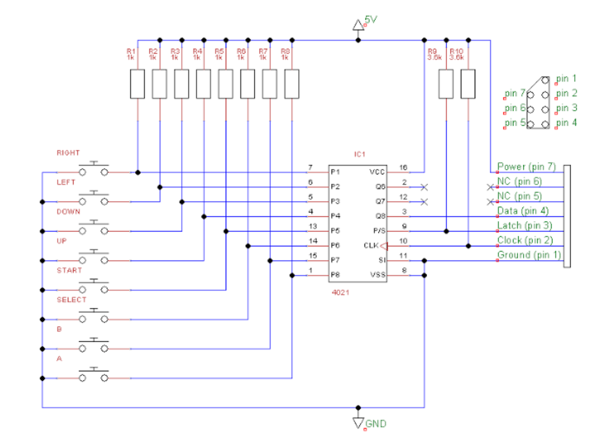
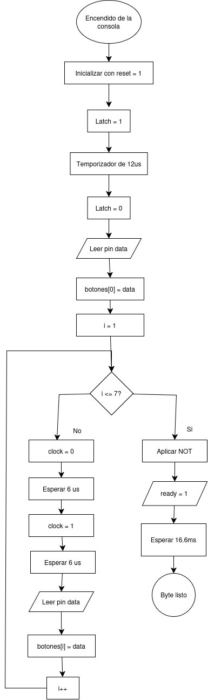
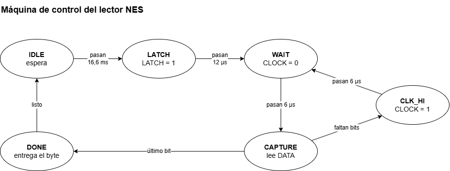
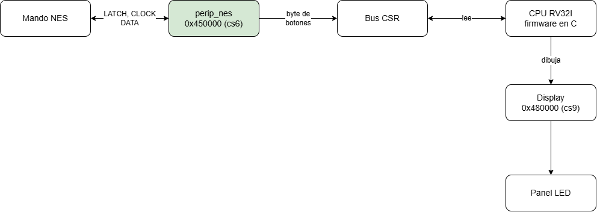
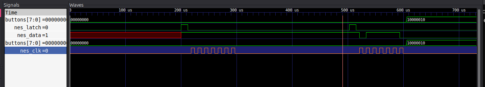

# Controlador NES

En el presente repositorio se encuentran los avances producidos y la información general para el desarrollo y la conexión del periférico mando NES en la consola KUBIX.

## Contenido

1. [Visión general](#1-visión-general)
2. [Conexión física](#2-conexión-física)
3. [Cómo funciona el mando](#3-cómo-funciona-el-mando)
4. [Protocolo de comunicación](#4-protocolo-de-comunicación)
5. [Especificaciones eléctricas](#5-especificaciones-eléctricas)
6. [Diseño interno](#6-diseño-interno)
7. [Interfaz con la CPU](#7-interfaz-con-la-cpu)
8. [Verificación](#8-verificación)
9. [Documentación adicional](#9-documentación-adicional)

---

## 1. Visión general

El mando se comunica con el SoC por un bus serie síncrono de solo lectura, con un modelo maestro-esclavo:

- **Master (maestro):** el módulo de la FPGA. Genera LATCH y CLOCK, y lee DATA.
- **Slave (esclavo):** el mando físico de la NES. Responde a cada pulso que recibe.



El mando envía **un byte** (8 botones), bit a bit, por la línea DATA.

## 2. Conexión física

Pines del conector del mando y su conexión en la FPGA (Colorlight i9, conector P1, según [`colorlight.lpf`](docs/testbench_1/colorlight.lpf)):

| Pin del mando | Señal | Dirección (desde la FPGA) | Pin de la FPGA |
|:-:|---|---|:-:|
| 1 | GND | Tierra | - |
| 2 | `nes_clk` (CLOCK) | Salida | G3 |
| 3 | `nes_latch` (LATCH) | Salida | F1 |
| 4 | `nes_data` (DATA) | Entrada | F3 |
| 7 | VCC | Alimentación (5 V) | - |

Los pines 5 y 6 del mando no están conectados.


> **Ojo con el voltaje:** el mando funciona a 5 V y los pines de la FPGA aceptan máximo 3,3 V. Verifica que el pin de DATA tolere 5 V; si no, usa un divisor de voltaje o un conversor de niveles.

## 3. Cómo funciona el mando

Cada botón del control corresponde a una entrada digital del registro de desplazamiento. La consola NES envía un pulso de sincronización (latch) a 60 Hz, lo que permite registrar el estado de los botones. Luego, el registro transmite esta información en serie por el pin 3 (Q8 o Data), recibida por el pin 10. Finalmente, la consola lee los datos, identifica qué botones están presionados y utiliza esta información para ejecutar las acciones correspondientes en el juego.




## 4. Protocolo de comunicación

Cada **16,6 ms** (60 Hz) se repite esta secuencia:


1. El master sube **LATCH** durante **12 µs**. El mando "congela" los botones.
2. Al bajar LATCH, espera 6 µs y lee DATA, que muestra el primer bit: el botón **A**.
3. El master envía **7 pulsos de CLOCK** (6 µs en alto y 6 µs en bajo). Después de cada pulso lee el siguiente botón.
4. Con los 8 bits leídos, espera hasta completar los 16,6 ms y repite.

**Lógica negativa:** un botón presionado vale `0` y uno suelto vale `1`. Por eso cada bit pasa por una compuerta NOT al llegar a la FPGA. Ejemplo con Start presionado:


## 5. Especificaciones eléctricas

- Comunicación serie, síncrona y unidireccional.
- La FPGA controla LATCH y CLOCK, y recibe DATA.
- Niveles TTL / LVTTL (5 V o 3,3 V): nivel bajo con $V_{IL} < 0{,}8\ \text{V}$ y nivel alto con $V_{IH} > 2{,}0\ \text{V}$.

## 6. Diseño interno

El módulo [`nes_controller.v`](docs/testbench_1/nes_controller.v) contiene una máquina de estados que genera LATCH y CLOCK, lee DATA y entrega el byte de botones. El parámetro `CLK_FREQ` (25 MHz en la Colorlight i9) debe coincidir con el reloj de la FPGA. De él se calculan todos los tiempos.

### 6.1 Diagrama de bloques


| Puerto | Dirección | Descripción |
|---|---|---|
| `clk` | Entrada | Reloj de la FPGA |
| `rst_n` | Entrada | Reset activo en bajo |
| `data` (`nes_data`) | Entrada | Línea DATA del mando |
| `latch` (`nes_latch`) | Salida | Línea LATCH hacia el mando |
| `clock` (`nes_clk`) | Salida | Línea CLOCK hacia el mando |
| `buttons[7:0]` | Salida | Botones: `1` = presionado |
| `start_read` | Entrada | Pendiente de implementar |
| `ready` | Salida | Pendiente de implementar |

### 6.2 Diagrama de flujo



### 6.3 Máquina de control



| Estado | Qué hace | Pasa al siguiente cuando |
|---|---|---|
| `IDLE` | Espera con LATCH y CLOCK en 0 | Pasan 16,6 ms |
| `LATCH` | Pone LATCH en 1 | Pasan 12 µs |
| `WAIT` | Baja LATCH y lee el bit A | Pasan 6 µs |
| `CLK_HIGH` | Pone CLOCK en 1 | Pasan 6 µs |
| `CLK_LOW` | Pone CLOCK en 0 y lee el siguiente bit | Pasan 6 µs. Si faltan bits vuelve a `CLK_HIGH`; si ya leyó los 8 pasa a `DONE` |
| `DONE` | Copia el byte a `buttons` | Siempre vuelve a `IDLE` |

### 6.4 Integración con el resto de la consola



Este diagrama muestra el camino que recorre una pulsación, desde que el jugador toca un botón hasta que el personaje se mueve en pantalla. Nuestro módulo, `perip_nes`, es la caja verde. 

Dentro de la FPGA hay un pequeño sistema (SoC) donde viven la CPU y varios periféricos. Todos se comunican por un mismo bus compartido, el **Bus CSR**. Cada periférico tiene su propia dirección. La del control NES es `0x450000`.

1. **El mando y `perip_nes` se comunican.** `perip_nes` envía al mando las señales `LATCH` y `CLOCK`, y el mando responde por `DATA` con el estado de cada botón, uno por uno.
2. **`perip_nes` arma un byte.** Junta los 8 botones en un solo número, donde cada bit es un botón (`1` = presionado). 
3. **La CPU lee ese byte por el bus.** El firmware en C lee los botones en `0x450000`.
4. **La CPU decide qué hacer y dibuja.** Según los botones, el juego mueve al personaje y escribe el nuevo dibujo en el Display (`0x480000`).
5. **El Display lo muestra en el Panel LED.**

En resumen, `perip_nes` es el "traductor" entre el mando y la CPU. Convierte las señales eléctricas del mando en un número que el programa puede leer, así que el resto de la consola no necesita conocer el protocolo del mando.

El control se usa en varios momentos del juego, como se ve en el [diagrama general](img/diagrama_general.drawio.png): selección de juego, verificación del periférico, tutorial y ejecución del juego. En la [lógica de juegos](img/diagrama_logica_juegos.drawio.png), Start alterna la pausa y Select vuelve al menú.

## 7. Interfaz con la CPU

| Dirección | Registro | Descripción |
|---|---|---|
| `0x450000` | Botones | Un byte: `1` = botón presionado |
| `0x450008` | Dato Listo | Indica que hay un byte nuevo |

| Botón | Bit | Máscara |
|---|:-:|:-:|
| A | 0 | `0x01` |
| B | 1 | `0x02` |
| Select | 2 | `0x04` |
| Start | 3 | `0x08` |
| Arriba | 4 | `0x10` |
| Abajo | 5 | `0x20` |
| Izquierda | 6 | `0x40` |
| Derecha | 7 | `0x80` |

Ejemplo: con solo Start presionado el byte vale `0x08`. 

## 8. Verificación

### 8.1 Simulación

El testbench [`tb_nes_controller.v`](docs/testbench_1/tb_nes_controller.v) emula el chip del mando y prueba tres casos: A y Start, Derecha y B, y todos los botones. Para acelerar la simulación, el control se lee a 5 kHz en lugar de 60 Hz. Para ejecutarla:

```bash
cd docs/testbench_1
make sim
make wave
```



En la captura se ven los pulsos de LATCH, los 7 pulsos de CLOCK y el byte `10000010` (Derecha y B) en `buttons`. Más detalles en [`info.md`](docs/testbench_1/info.md).

### 8.2 Prueba en la FPGA

El módulo [`nes_uart_top.v`](docs/testbench_1/nes_uart_top.v) conecta el controlador con un transmisor UART (115200 baudios). Envía 10 veces por segundo una línea con una letra por botón (`A B S T U D L R`) y un guion si el botón está suelto. También saca los 8 botones por pines de la FPGA, para conectar LEDs.

Para construirlo y programarlo hacen falta Yosys, nextpnr-ecp5, ecppack y openFPGALoader:

```bash
cd docs/testbench_1
make
make prog
```


### 8.3 Verificación con analizador lógico

Se conectó un analizador lógico de 8 canales entre una consola NES real y su control, para comparar las señales con las del diseño. Los detalles y las dificultades por la diferencia de voltajes están en [`verificación_protocolo_comunicacion.md`](<docs/testbench_1/verificación_protocolo_comunicacion.md>).

## 9. Documentación adicional

| Documento | Contenido |
|---|---|
| [`def_tramas.md`](def_tramas.md) | Tramas, polaridad lógica y vectores de prueba |
| [`mapa_controlador_NES.md`](mapa_controlador_NES.md) | Orden de los bits y máscaras en C |
| [`verificacion_botones.md`](verificacion_botones.md) | Enmascaramiento, flancos y filtro de direcciones opuestas |
| [`docs/testbench_1/info.md`](docs/testbench_1/info.md) | Testbench y resultados de simulación |
| [`img/diagrama_general.drawio.png`](img/diagrama_general.drawio.png) | Flujo general de la consola |
| [`img/diagrama_logica_juegos.drawio.png`](img/diagrama_logica_juegos.drawio.png) | Lógica de los juegos |

## Autores

- Juana Valentina Saavedra
- Manuel Alejandro Velasco Marinez
