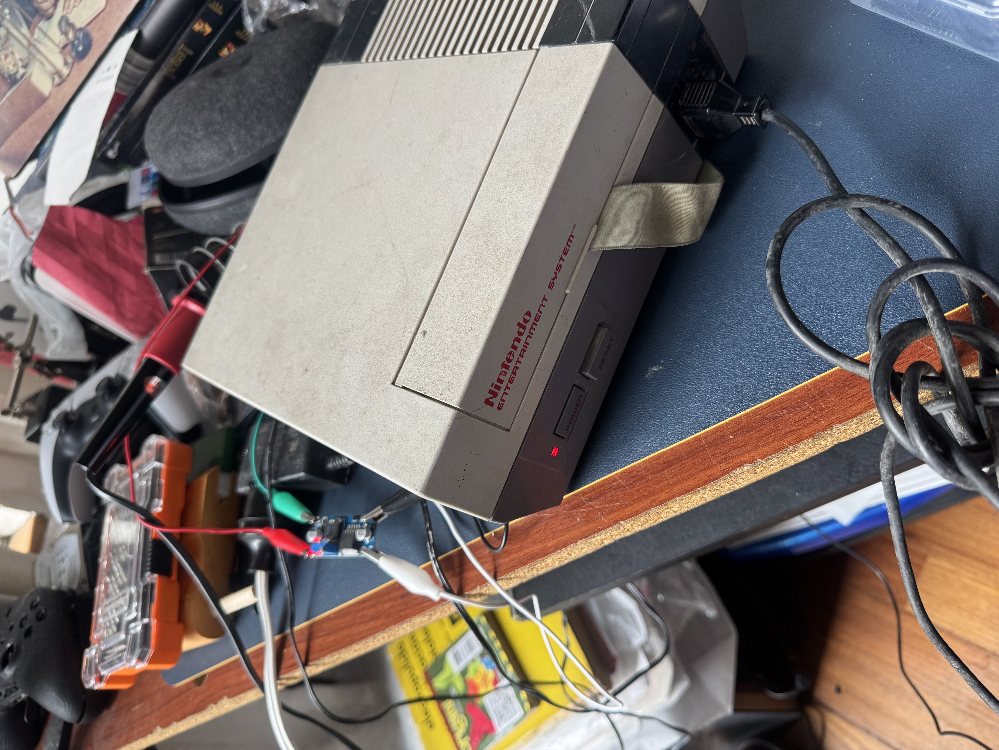
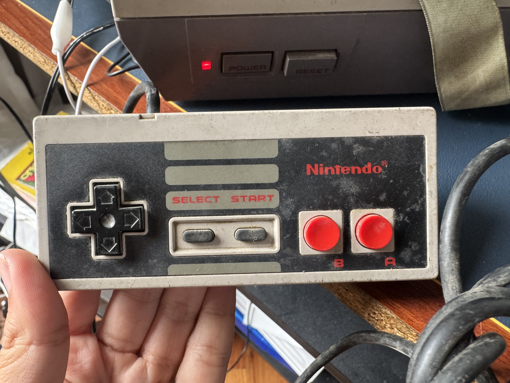

# Verificación práctica de las señales hacia el control de NES 
Con el propósito de verificar el protocolo de comunicaciones diseñado, se obtuvo una consola NES y su respectivo control. Se plantea el uso de un analizador lógico de 8 canales conectado en paralelo entre la consola y el control. Se presentan dificultades para analizar las señales que recibe el control debido a diferencias en la tensión admitida por la FPGA 

