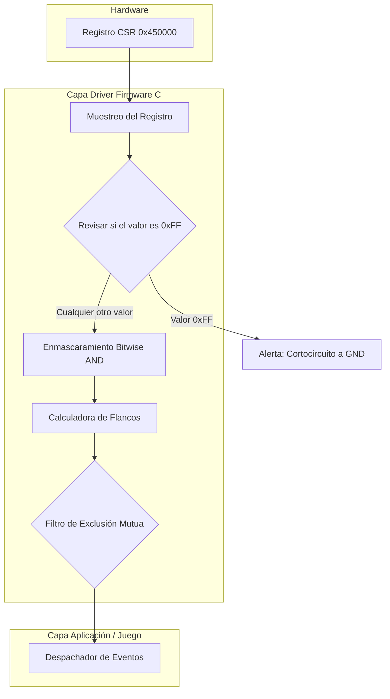
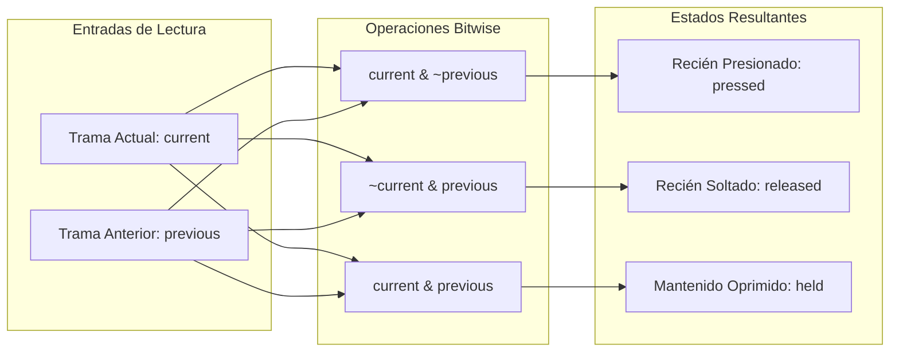
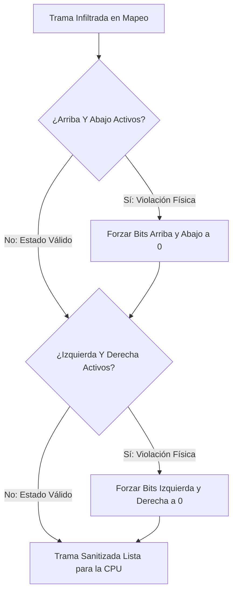

#  Verificación de Botones



---

# Enmascaramiento Bitwise AND

Filtro para aislar la presencia de cada botón dentro del byte recibido.

| Botón | Máscara Hexadecimal | Máscara Binaria | Condición Lógica en C |
| :--- | :---: | :---: | :--- |
| Botón A | `0x01` | `00000001` | `(trama & 0x01) != 0` |
| Botón B | `0x02` | `00000010` | `(trama & 0x02) != 0` |
| Select | `0x04` | `00000100` | `(trama & 0x04) != 0` |
| Start | `0x08` | `00001000` | `(trama & 0x08) != 0` |
| Arriba (Up) | `0x10` | `00010000` | `(trama & 0x10) != 0` |
| Abajo (Down) | `0x20` | `00100000` | `(trama & 0x20) != 0` |
| Izquierda (Left) | `0x40` | `01000000` | `(trama & 0x40) != 0` |
| Derecha (Right) | `0x80` | `10000000` | `(trama & 0x80) != 0` |

---

# Detección de Flancos

Cálculo del cambio de estado mediante la comparación entre la trama del ciclo actual (`current`) y el ciclo previo (`previous`).



---

# Sanitización de Direcciones Opuestas

Corrección de datos inválidos por colisión física en la cruceta (direcciones opuestas simultáneas).



---

# Implementación en C

```c
#include <stdint.h>

#define NES_PORT_ADDR 0x450000
#define IO_NES        (*((volatile uint32_t *)NES_PORT_ADDR))

#define NES_MASK_A      0x01
#define NES_MASK_B      0x02
#define NES_MASK_SELECT 0x04
#define NES_MASK_START  0x08
#define NES_MASK_UP     0x10
#define NES_MASK_DOWN   0x20
#define NES_MASK_LEFT   0x40
#define NES_MASK_RIGHT  0x80

typedef struct {
    uint8_t current;   // botones presionados ahora
    uint8_t pressed;   // recién presionados
    uint8_t released;  // recién soltados
    uint8_t held;      // siguen presionados
} NES_Controller;

static uint8_t previous_frame = 0;

void nes_update(NES_Controller *pad) {
    uint8_t raw = (uint8_t)(IO_NES & 0xFF);

    // 0xFF = los 8 botones a la vez: no pasa en un mando real.
    // Se toma como cortocircuito a GND y se ignora.
    if (raw == 0xFF) {
        raw = 0;
    }

    // Dos direcciones opuestas a la vez tampoco son posibles: se ignoran
    if ((raw & NES_MASK_UP) && (raw & NES_MASK_DOWN))    raw &= ~(NES_MASK_UP | NES_MASK_DOWN);
    if ((raw & NES_MASK_LEFT) && (raw & NES_MASK_RIGHT)) raw &= ~(NES_MASK_LEFT | NES_MASK_RIGHT);

    // Cálculo de flancos
    pad->current  = raw;
    pad->pressed  = raw & ~previous_frame;
    pad->released = ~raw & previous_frame;
    pad->held     = raw & previous_frame;

    previous_frame = raw;
}
```
